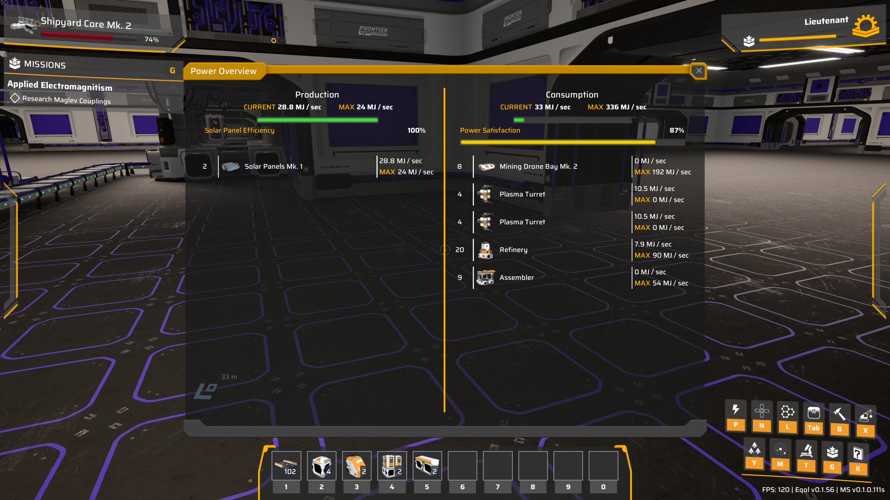
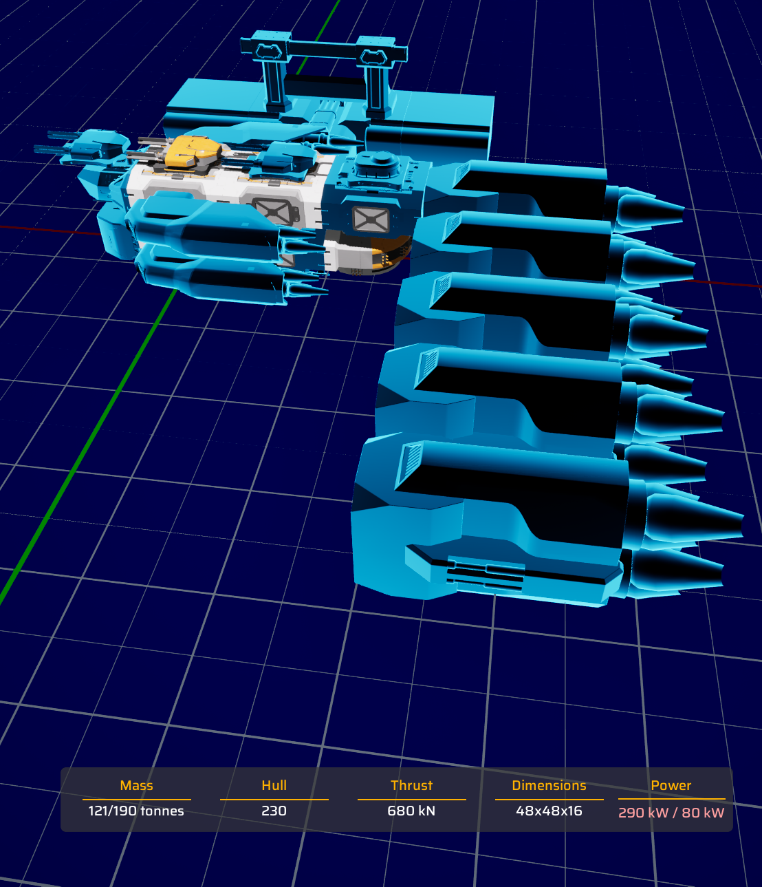
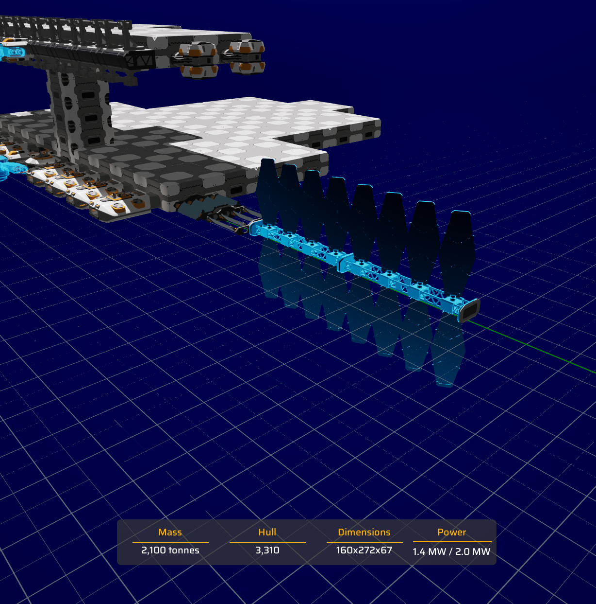

# Elvenide's Power QoL

**Elvenide's Power QoL** is a power-management quality-of-life mod for **Main Sequence** adding a station-wide Power Overview hotkey, colored satisfaction progress bars, and Ship/Station Designer power stats, built with UE4SS Lua.

It is designed to feel native to the base game—matching its exact UI style—and is **100% save-safe and removable** without adding custom items, machines, or save dependencies.

## Getting Started

- **[Getting Started & Installation Guide](docs/get-started.md)**

## Power Overview Enhancements

Quickly check your station's power grid from anywhere inside a space station and see power efficiency at a glance.

*Power Overview opened via hotkey showing Production and Consumption summary bars and the color-coded Power Satisfaction readout.*

### Features

- **Global Power Overview Hotkey (Default: `P`)**
  - Press `P` while on foot in a space station to open the Power Overview window immediately -- no need to walk up to a machine first.
  - Press `P` again while the Power Overview is open to close it.
  - A **Power (`P`)** keybind indicator appears in the top-right HUD while on foot in a space station and updates automatically if you rebind the key.
- **Summary Header Progress Bars**
  - **Production (`Current / Max`)**: Static green bar showing how much of your maximum power generation capacity is currently being produced.
  - **Consumption (`Current / Max`)**: Static green bar showing how much of your maximum power demand is currently being drawn.
  - **Power Satisfaction (`Production / Consumption`)**: Dynamic status bar with percentage readout that shifts color based on grid health:
    - **Green**: 100%+ satisfaction (full power)
    - **Amber**: 50%–99% satisfaction (brownout)
    - **Red**: Under 50% satisfaction (severe power deficit)

### Configuration

- **In-Game**: Open **Settings → Controls** and look for **Power Overview** to rebind the key, revert to default (`P`), or clear the binding.
- **Config File**: Stored in `MainSequencePowerQoL/config.json` under `"PowerOverviewKey"`.

## Designer Power Stats

See total power generation and power consumption directly inside the **Ship Designer** and **Station Designer**.

### Features

- Adds a **Power** column alongside existing stats (such as Mass, Hull, and Dimensions) in the designers, displaying `[consumption] / [production]`.
- Automatically updates as you add, remove, or modify power-generating blocks (solar panels, reactors) and power-consuming blocks/machines in your blueprint.
- Highlights the **Power** value in red when consumption exceeds generation so you can spot power deficits before finalizing a build.

### Examples

*Ship Designer HUD displaying the Power column (`290 kW / 80 kW`) highlighted in red when consumption exceeds generation.*

*Station Designer HUD displaying the Power column (`1.4 MW / 2.0 MW`) alongside Mass, Hull, and Dimensions.*

## Credits

**Elvenide's Power QoL** is created and maintained by Elvenide. This is an unofficial mod and I'm not affiliated with Main Sequence.

> If you have questions or run into issues, feel free to reach out in #modding-guides within the [official Main Sequence Discord server](https://discord.com/invite/uy8w2pTcQE).
